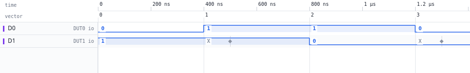
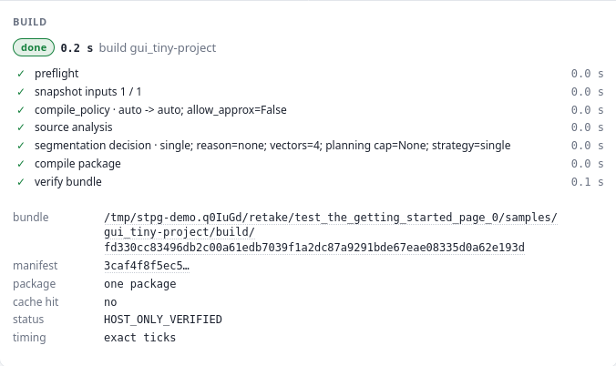
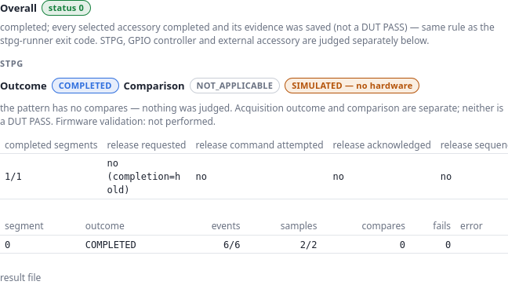

# Getting started

This page takes you from a source download to a finished simulated run. It needs no hardware: real-device access is
disabled. No public Release or package-index entry is assumed.

## 1. Install

You need Python 3.10 or later and a current browser (Chrome, Edge or Firefox).
macOS is untested and not actively supported. The shell commands are provided
as a starting point for anyone who wants to try it.

Extract the source download and open a terminal in the folder containing `pyproject.toml`. Internet access may be
needed for Python build dependencies and pyserial. The STPG package itself is installed from this folder, not
looked up by name on an index. Use a new `stpg-env` folder if that name is already used by a different environment.

Windows PowerShell (copy these lines as written):

```powershell
python -m venv stpg-env
.\stpg-env\Scripts\python.exe -m pip install .
.\stpg-env\Scripts\python.exe -m stpgview --help
```

Linux / macOS:

```sh
python3 -m venv stpg-env
./stpg-env/bin/python -m pip install .
./stpg-env/bin/python -m stpgview --help
```

You do not need to activate the environment or add its Scripts folder to PATH. In particular, a user-level pip
install can succeed while bare `stpg-view` or `stpg-examples` commands are not found; the module commands here avoid
that problem. [Python's virtual-environment guide](https://docs.python.org/3.13/library/venv.html) explains explicit
interpreter paths. If you use local wheels instead, see [developer installation](development/interfaces.md).

## 2. Make a sample pattern

Windows PowerShell:

```powershell
.\stpg-env\Scripts\python.exe -m stpgview.physical.patterns samples
```

Linux / macOS:

```sh
./stpg-env/bin/python -m stpgview.physical.patterns samples
```

This writes small public patterns into a new folder `samples/`. They drive only a few pins and compare nothing, so
their results do not depend on a device. `gui_tiny.stil` has four vectors. The command refuses an existing non-empty
folder without overwriting it: skip this step if the samples already exist, or choose a new folder name.

## 3. Start in demo mode

Windows PowerShell:

```powershell
.\stpg-env\Scripts\python.exe -m stpgview --demo-device --no-device-run --config-dir ./settings-check --results-dir ./runs-check
```

Linux / macOS:

```sh
./stpg-env/bin/python -m stpgview --demo-device --no-device-run --config-dir ./settings-check --results-dir ./runs-check
```

A browser tab opens. If it does not, paste the address printed in the terminal, including `token=`. Stop the program
with `Ctrl+C` in the terminal.

The terminal also prints the [settings folder](settings-folder.md). These commands use `settings-check` inside this
folder, not your existing settings. Do not reuse that name if it holds other settings you want to keep separate.
The `runs-check` folder is for results outside a project; a project's results stay in its own folder.

`--demo-device` adds a simulated STPG named `simulated`. `--no-device-run` prevents real-device execution without
disabling the simulator. Its results are marked SIMULATED and say nothing about a device or a board.

## 4. Look at the pattern

On the **Viewer** page press **Open…**, choose `samples/gui_tiny.stil` and open it. The upper part is the waveform and
the lower part is the vector table. The [Viewer](viewer.md) page explains the marks.



The waveform panel shows the input from this walkthrough, not a measured waveform. In the Viewer the vector table
is below this panel.

## 5. Build it

1. Press **Build in Runner…**. The Runner opens the **New runner project** dialog, filled in from the open file. Choose a new
   project folder; do not select a folder containing another project or other files.
2. Choose **Wait preset** `none` and **Completion** `hold`. Leave the other settings as they are.
3. Press **Create**, then **Build**.

The build reports each stage. **Verify** checks the result and **Plan** shows what would run; neither touches a device.



The build ends at `HOST_ONLY_VERIFIED`: a host check of the bundle, before any run. The folder, hashes and times
are examples from the walkthrough.

## 6. Run it

1. In **3 · Run** choose the device `simulated`.
2. Press **Run…**. A confirmation lists exactly what will run.
3. Tick every statement and press **Start run**.

The result shows **Outcome** and **Comparison** separately, and the folder of the result files. A project stores
its runs in its own `results/` directory, for example `samples/gui_tiny-project/results/` with the suggested name.
The word SIMULATED must be present: this confirms the walkthrough did not exercise real hardware.



Actual simulated-run result panel. COMPLETED is not a hardware or DUT pass; this sample has no comparisons.

These panels are captured from the installed program during `test_getting_started_browser.py`, with hardware access
disabled and an empty PATH. See
[GUI testing](testing-gui.md) to reproduce the browser walkthrough.

## Next

- For a real run, read [Hardware](hardware.md), then add your STPG with **Devices…** in the Runner.
- To work on your own pattern, see [Viewer](viewer.md) and [Runner](runner.md).
